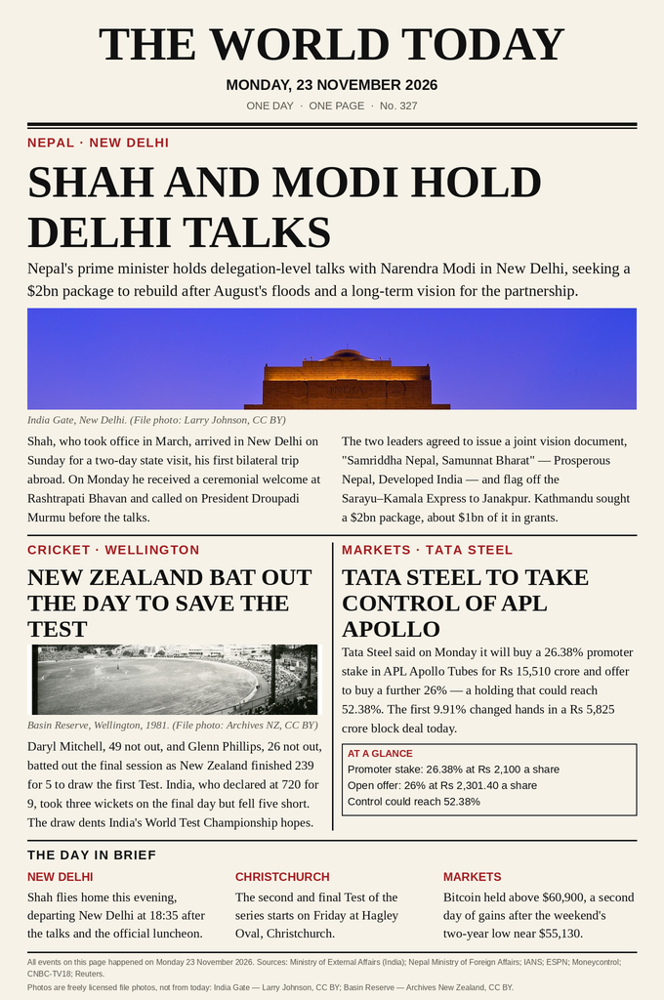

# news-image-20261123

[](https://make.fun/bounty/news-image-20261123?utm_source=github&utm_medium=readme&utm_campaign=news-image-20261123)
[](https://make.fun/bounty/news-image-20261123/leaderboard?utm_source=github&utm_medium=readme&utm_campaign=news-image-20261123)
[](https://make.fun/bounty/news-image-20261123?utm_source=github&utm_medium=readme&utm_campaign=news-image-20261123)

A broadsheet summing up the world's news of **Monday 23 November 2026** in one
image — an entry for make.fun's
[Sum up 23 November's world news in one image](https://make.fun/bounty/news-image-20261123)
bounty ($100, top 50 share).



## The day, in brief

- **New Delhi** — Nepal's prime minister, Balendra Shah, held
  delegation-level talks with Narendra Modi, his first bilateral visit abroad
  since taking office in March. The two leaders agreed to issue a joint
  vision document, "Samriddha Nepal, Samunnat Bharat", and Kathmandu sought
  a $2bn package for flood reconstruction.
- **Wellington** — New Zealand batted out the final day to draw the first
  Test: 239 for 5 in 120 overs, Mitchell 49 not out and Phillips 26 not out,
  after India declared at 720 for 9.
- **Markets** — Tata Steel said it will buy a 26.38% promoter stake in APL
  Apollo Tubes for ₹15,510 crore and launch an open offer for a further 26%,
  a holding that could reach 52.38%. Bitcoin held above $60,900, a second
  day of gains after the weekend's slide to a two-year low near $55,130.

Every story's event was date-checked against primary sources: the event
itself happened on 23 November 2026, not merely reported then.

## How it works

`tools/render.py` draws the broadsheet (680×1024 PNG) from real, freely
licensed photographs and the verified news text. `main.py` copies the
finished image to `/output/entry.png` — no network, no randomness, the same
bytes on every run.

```sh
python3 tools/render.py   # rebuild entry.png
python3 main.py           # write /output/entry.png
```

## Photo credits (file photos, not from the day)

- India Gate, New Delhi — Larry Johnson, CC BY
- Basin Reserve, Wellington, NZ v India 1981 — Archives New Zealand, CC BY
- Narendra Modi portrait — theglobalpanorama, CC BY-SA

## Licence

MIT — see [LICENSE](LICENSE).
